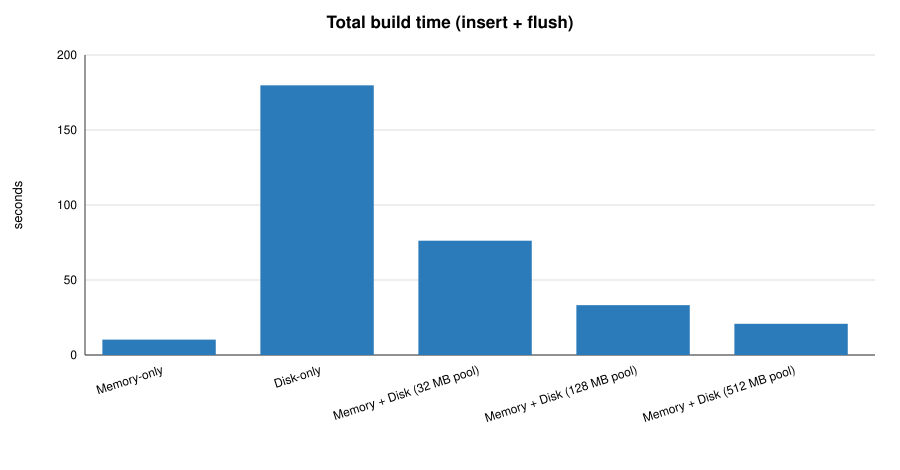
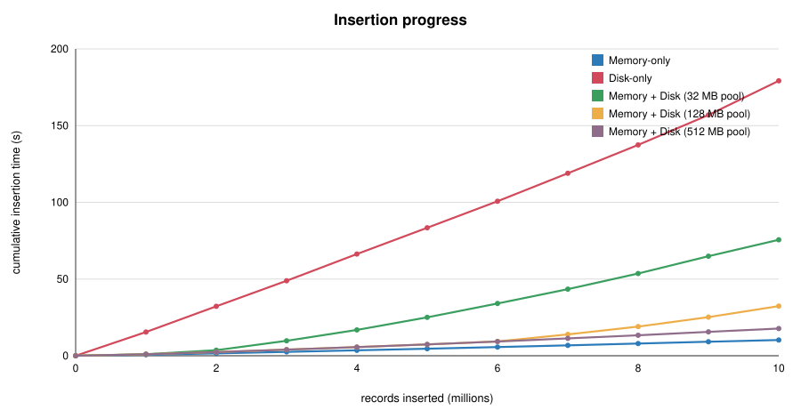
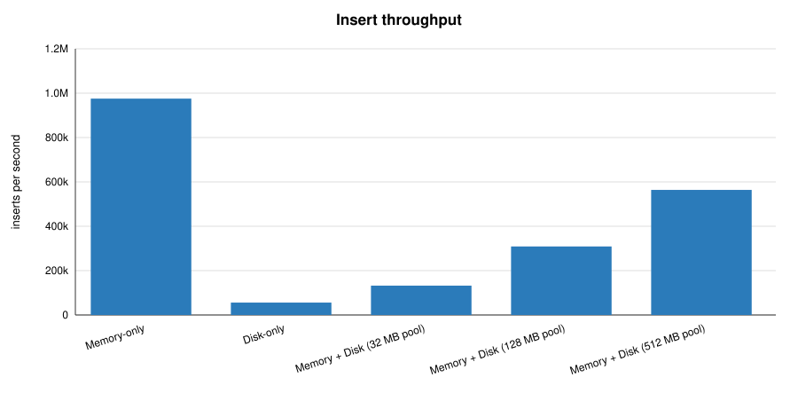
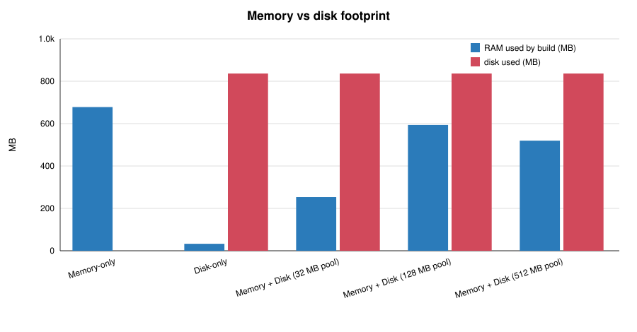
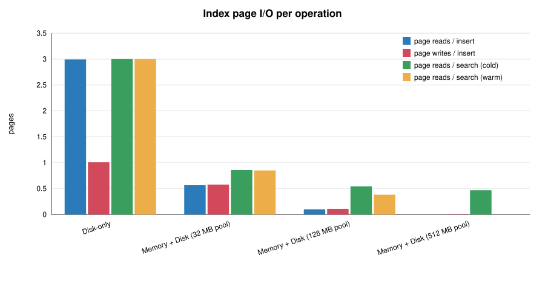
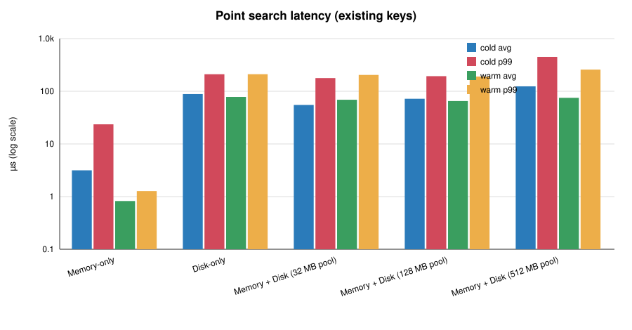
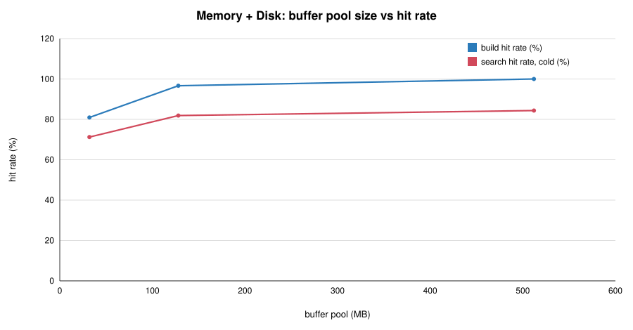

# B+ Tree Implementation – Benchmark Report

_Generated 2026-10-10 00:43 by `bptree_report`. All numbers are measured, not estimated._

## 1. Setup

| Item | Value |
|---|---|
| Dataset | `bplus_tree_data_10m.csv` (705.7 MB, 10,000,000 rows) |
| Records indexed | 10,000,000 |
| Key | unique alphanumeric, avg 8.0 B, max 8 B |
| Payload | avg 64.0 B |
| Machine | Darwin 22.4.0 x86_64 · 16 CPUs · 8.0 GB RAM |
| Implementation | C++17 (clang 14.0.3 (clang-1403.0.22.14.1), -O3) |
| Queries | 100,000 existing-key lookups, 10,000 missing-key lookups, 1,000 range scans × 100 records (seed 42) |

## 2. Assumptions

**Node / page size:** 4096 bytes (typical OS / SSD page). One B+ tree node = one page.
**Key storage:** fixed-width slot of 8 bytes (= longest key in the dataset), zero-padded. Zero padding keeps byte-wise order identical to string order.
**Page layout:** 16 B header (node type, key count, next-leaf page id, reserved) + key area + pointer area.
**Leaf order:** ⌊(4096 − 16) / (8 + 8)⌋ = **255 keys** per leaf (8 B record pointer = 40-bit offset + 24-bit length).
**Internal order:** ⌊(4096 − 16 − 4) / (8 + 4)⌋ = **339 keys / 340 children** (4 B child page id).
The memory-only tree uses the **same capacities**, so all three trees have the same shape and only the storage medium differs.
**Storage structure (disk variants):** `index.db` = array of fixed-size pages, page 0 = meta page (root id, height, counters); `heap.db` = append-only payload file. Leaves store only (key, pointer), so fan-out does not depend on payload size.
**Memory-only payloads** live in an in-RAM append-only arena (64 MB blocks); leaves hold the same 8 B pointer format as on disk.
**Disk-only:** zero caching in the program – every node visit is a `pread` of one page, every modification an immediate `pwrite`, every payload append its own write.
**Memory + Disk:** buffer pool of 32 MB, 128 MB, 512 MB (8,192, 32,768, 131,072 pages). Internal nodes are pinned in RAM; leaves use LRU replacement. Dirty pages are written back only on eviction or flush; payload appends go through a 1 MB write buffer. On open, the internal levels are loaded into the pool.
**Insertion order:** CSV order (already randomly shuffled). Only `insert()` is timed; CSV parsing is excluded. Disk builds include the final flush + fsync.
**Duplicate keys:** keys are unique; a repeated key would overwrite the value. Deletion is not part of the assignment.
**I/O counts are logical page I/Os** issued by the program. The OS page cache was left on, so some reads may be served from kernel RAM; `--direct-io` bypasses it on macOS.
**RAM used by build** = process RSS after the build minus RSS before it; it includes a small fixed benchmark overhead (one CSV chunk + the sampled query keys) common to all variants.
Each variant runs in a separate process, so RAM measurements are independent.

## 3. Summary

| Metric | Memory-only | Disk-only | Memory + Disk (32 MB pool) | Memory + Disk (128 MB pool) | Memory + Disk (512 MB pool) |
|---|---|---|---|---|---|
| Build time (insert + flush) | 10.25 s | 3.0 min | 76.20 s | 33.23 s | 20.80 s |
| Insert throughput | 975,333 /s | 55,797 /s | 132,288 /s | 308,893 /s | 563,850 /s |
| Avg insert latency | 1.03 µs | 17.92 µs | 7.56 µs | 3.24 µs | 1.77 µs |
| Point search avg (cold) | 3.16 µs | 88.56 µs | 55.00 µs | 72.06 µs | 124.13 µs |
| Point search avg (warm) | 0.82 µs | 78.18 µs | 69.04 µs | 65.28 µs | 75.09 µs |
| Tree height | 3 | 3 | 3 | 3 | 3 |
| RAM used by build | 678.1 MB | 32.9 MB | 253.3 MB | 593.7 MB | 519.6 MB |
| Disk used | 0 B | 836.3 MB | 836.3 MB | 836.3 MB | 836.3 MB |
| Page I/O during build (R / W) | - | 29,938,426 / 10,115,708 | 5,706,590 / 5,764,449 | 999,337 / 1,057,196 | 0 / 57,859 |
| Page reads per search (cold) | - | 3.00 | 0.86 | 0.54 | 0.47 |

## 4. Insertion

| Metric | Memory-only | Disk-only | Memory + Disk (32 MB pool) | Memory + Disk (128 MB pool) | Memory + Disk (512 MB pool) |
|---|---|---|---|---|---|
| Records | 10,000,000 | 10,000,000 | 10,000,000 | 10,000,000 | 10,000,000 |
| Insert time | 10.25 s | 3.0 min | 75.59 s | 32.37 s | 17.74 s |
| Flush time | 0.0 µs | 560.6 ms | 606.7 ms | 855.5 ms | 3.07 s |
| Total build time | 10.25 s | 3.0 min | 76.20 s | 33.23 s | 20.80 s |
| Throughput | 975,333 inserts/s | 55,797 inserts/s | 132,288 inserts/s | 308,893 inserts/s | 563,850 inserts/s |
| Avg time per insert | 1.03 µs | 17.92 µs | 7.56 µs | 3.24 µs | 1.77 µs |
| Wall time incl. CSV parsing | 14.88 s | 3.6 min | 103.00 s | 61.83 s | 60.81 s |

## 5. Tree structure

| Metric | Memory-only | Disk-only | Memory + Disk (32 MB pool) | Memory + Disk (128 MB pool) | Memory + Disk (512 MB pool) |
|---|---|---|---|---|---|
| Height (levels, root..leaf) | 3 | 3 | 3 | 3 | 3 |
| Leaf nodes | 57,597 | 57,597 | 57,597 | 57,597 | 57,597 |
| Internal nodes | 257 | 257 | 257 | 257 | 257 |
| Total nodes / pages | 57,854 | 57,854 | 57,854 | 57,854 | 57,854 |
| Leaf capacity (order) | 255 | 255 | 255 | 255 | 255 |
| Internal capacity / max fan-out | 339 / 340 | 339 / 340 | 339 / 340 | 339 / 340 | 339 / 340 |
| Avg leaf fill factor | 68.1 % | 68.1 % | 68.1 % | 68.1 % | 68.1 % |

Theory check: with random inserts nodes are ~ln 2 ≈ 69 % full, so the expected height is 1 + ⌈log236(10,000,000 / 177)⌉ = **4**. Measured: **3**.

## 6. Memory and disk usage

| Metric | Memory-only | Disk-only | Memory + Disk (32 MB pool) | Memory + Disk (128 MB pool) | Memory + Disk (512 MB pool) |
|---|---|---|---|---|---|
| RSS before build | 9.0 MB | 8.8 MB | 9.9 MB | 8.9 MB | 10.0 MB |
| RSS after build | 687.1 MB | 41.8 MB | 263.1 MB | 602.5 MB | 529.6 MB |
| RAM used by build (delta) | 678.1 MB | 32.9 MB | 253.3 MB | 593.7 MB | 519.6 MB |
| Peak RSS | 1007.0 MB | 43.2 MB | 263.2 MB | 602.6 MB | 529.8 MB |
| RAM per record | 71.1 B | 3.5 B | 26.6 B | 62.2 B | 54.5 B |
| Index file | 0 B | 226.0 MB | 226.0 MB | 226.0 MB | 226.0 MB |
| Heap (payload) file | 0 B | 610.4 MB | 610.4 MB | 610.4 MB | 610.4 MB |
| Total disk | 0 B | 836.3 MB | 836.3 MB | 836.3 MB | 836.3 MB |
| Disk per record | 0.0 B | 87.7 B | 87.7 B | 87.7 B | 87.7 B |

## 7. Disk I/O

### During the build

| Metric | Disk-only | Memory + Disk (32 MB pool) | Memory + Disk (128 MB pool) | Memory + Disk (512 MB pool) |
|---|---|---|---|---|
| Index page reads | 29,938,426 | 5,706,590 | 999,337 | 0 |
| Index page writes | 10,115,708 | 5,764,449 | 1,057,196 | 57,859 |
| Page reads / insert | 2.994 | 0.571 | 0.100 | 0.000 |
| Page writes / insert | 1.012 | 0.576 | 0.106 | 0.006 |
| Heap write calls | 10,000,000 | 611 | 611 | 611 |
| Data written to index | 38.6 GB | 22.0 GB | 4.0 GB | 226.0 MB |
| Buffer pool hit rate | - | 80.9 % | 96.7 % | 100.0 % |
| Evictions / dirty write-backs | - | 5,756,252 / 5,764,444 | 1,024,423 / 1,057,191 | 0 / 57,854 |

### During search (per query)

| Metric | Disk-only | Memory + Disk (32 MB pool) | Memory + Disk (128 MB pool) | Memory + Disk (512 MB pool) |
|---|---|---|---|---|
| Point hit – page reads (cold) | 3.00 | 0.86 | 0.54 | 0.47 |
| Point hit – page reads (warm) | 3.00 | 0.85 | 0.38 | 0.00 |
| Point hit – heap reads | 1.00 | 1.00 | 1.00 | 1.00 |
| Point miss – page reads (cold) | 3.00 | 0.86 | 0.43 | 0.01 |
| Range scan – page reads (cold) | 3.59 | 1.37 | 0.27 | 0.10 |
| Range scan – heap reads | 100.00 | 100.00 | 100.00 | 100.00 |
| Pool hit rate (cold searches) | - | 71.2 % | 81.9 % | 84.4 % |
| Reopen time | 69.2 µs | 67.3 µs | 120.1 µs | 282.7 µs |
| Warm-up (internal nodes loaded) | - | 257 pages in 863.0 µs | 257 pages in 840.6 µs | 257 pages in 22.1 ms |

## 8. Search performance

### Cold pass (right after reopening from disk)

| Metric | Memory-only | Disk-only | Memory + Disk (32 MB pool) | Memory + Disk (128 MB pool) | Memory + Disk (512 MB pool) |
|---|---|---|---|---|---|
| Point hit avg / p50 | 3.16 / 2.73 µs | 88.56 / 100.93 µs | 55.00 / 93.03 µs | 72.06 / 94.31 µs | 124.13 / 101.28 µs |
| Point hit p95 / p99 | 7.09 / 23.58 µs | 176.15 / 210.61 µs | 111.64 / 178.13 µs | 107.72 / 193.73 µs | 251.04 / 450.27 µs |
| Point hit throughput | 316,756 /s | 11,292 /s | 18,182 /s | 13,876 /s | 8,056 /s |
| Point miss avg | 0.67 µs | 7.35 µs | 4.30 µs | 2.62 µs | 2.48 µs |
| Range scan avg | 105.83 µs | 6815.49 µs | 4715.94 µs | 5168.37 µs | 9153.70 µs |
| Range scan p99 | 222.37 µs | 10398.29 µs | 6907.90 µs | 9334.11 µs | 16851.73 µs |

### Warm pass (same queries again)

| Metric | Memory-only | Disk-only | Memory + Disk (32 MB pool) | Memory + Disk (128 MB pool) | Memory + Disk (512 MB pool) |
|---|---|---|---|---|---|
| Point hit avg / p50 | 0.82 / 0.79 µs | 78.18 / 100.47 µs | 69.04 / 96.75 µs | 65.28 / 93.59 µs | 75.09 / 92.86 µs |
| Point hit p95 / p99 | 1.10 / 1.27 µs | 182.49 / 210.96 µs | 155.77 / 204.53 µs | 108.63 / 190.42 µs | 220.18 / 258.01 µs |
| Point hit throughput | 1,213,528 /s | 12,790 /s | 14,483 /s | 15,318 /s | 13,317 /s |
| Point miss avg | 0.56 µs | 7.40 µs | 4.18 µs | 2.64 µs | 0.65 µs |
| Range scan avg | 17.73 µs | 5390.16 µs | 5099.82 µs | 4884.36 µs | 6397.08 µs |
| Range scan p99 | 19.98 µs | 9526.50 µs | 6474.67 µs | 6324.44 µs | 9212.93 µs |

## 9. Correctness

| Metric | Memory-only | Disk-only | Memory + Disk (32 MB pool) | Memory + Disk (128 MB pool) | Memory + Disk (512 MB pool) |
|---|---|---|---|---|---|
| Existing keys found with correct payload | 100,000 / 100,000 | 100,000 / 100,000 | 100,000 / 100,000 | 100,000 / 100,000 | 100,000 / 100,000 |
| Missing keys correctly not found | 10,000 / 10,000 | 10,000 / 10,000 | 10,000 / 10,000 | 10,000 / 10,000 | 10,000 / 10,000 |
| Range results sorted | yes | yes | yes | yes | yes |
| Range result digest | `30e27bba95c7` | `30e27bba95c7` | `30e27bba95c7` | `30e27bba95c7` | `30e27bba95c7` |
| Full structural validate() | passed | passed | passed | passed | passed |

All variants return **identical** range-scan results (same digest).

## 10. Buffer pool sweep (Memory + Disk)

| Pool | Pages | Build | Hit rate | Page reads | Page writes | Search avg (cold) |
|---|---|---|---|---|---|---|
| 32 MB | 8,192 | 76.20 s | 80.9 % | 5,706,590 | 5,764,449 | 55.00 µs |
| 128 MB | 32,768 | 33.23 s | 96.7 % | 999,337 | 1,057,196 | 72.06 µs |
| 512 MB | 131,072 | 20.80 s | 100.0 % | 0 | 57,859 | 124.13 µs |

## Observations

**Disk-only vs memory-only:** building is 17.5× slower and a cold point search is 28.1× slower. Every insert costs ≈ 3.0 page reads (one per level) plus 1.01 page writes, and every page is (de)serialised.
**Memory-only** is fastest but needs 678.1 MB of RAM (≈ 71 B per record), while the disk variants keep the same data in 836.3 MB on disk with almost no RAM.
**Memory + Disk** cuts index page reads during the build from 29,938,426 to 999,337 and writes from 10,115,708 to 1,057,196, giving a 5.4× faster build than disk-only with a 128 MB pool.
With the internal nodes pinned, a cold search in the hybrid tree needs at most one page read (the leaf) – measured 0.54 – versus 3.00 (= tree height) for disk-only.
Hybrid build takes 3.2× the memory-only time while using 593.7 MB instead of 678.1 MB of RAM – the classic database trade-off of a bounded buffer pool.
Height stays small (3 levels for 10,000,000 records) because a 4096 B page gives a fan-out of 340, so search cost grows only logarithmically.
Range scans use the leaf sibling chain: after one root-to-leaf descent only consecutive leaves are read.
Implemented in C++17 (-O3), so timings and RAM reflect the data structure and storage design rather than language overhead.
